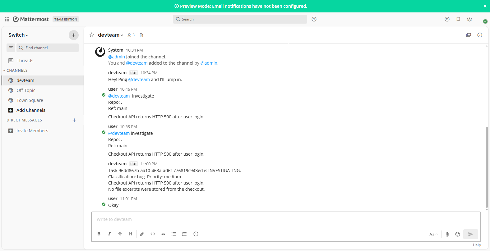
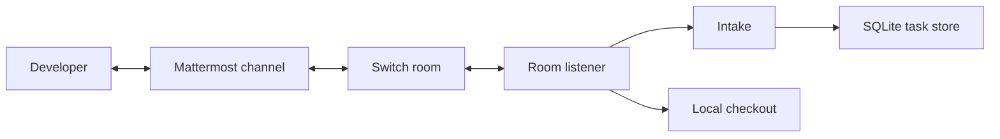

# DevTeam

DevTeam is a Python engineering teammate that joins a Switch room and works with developers in Mattermost. A person reports a checkout failure in the channel. The agent classifies it, stores a task, and replies in the same thread with a task id, a classification, and a priority.

Built for the [Flip the Switch](https://www.wemakedevs.org/hackathons/switch) hackathon on the Best Business Workflow track. The recorded room is a medium bug: Checkout API returns HTTP 500 after user login. The agent posted task `96dd867b-aa10-468a-ad6f-776819c943ed` as `INVESTIGATING`.

## Project details

| | |
|---|---|
| Product | Collaborative software incident workflow |
| Author | [Manoj Kumar Sah](https://www.linkedin.com/in/manoj-kumar-sah) |
| GitHub | [github.com/Manojkr6637](https://github.com/Manojkr6637) |
| Repository | [manojkr-ai-labs/devteam-ai](https://github.com/manojkr-ai-labs/devteam-ai) |
| Room | Public Mattermost channel `devteam`, bridged by Switch |
| Agent | One Switch agent, named `devteam` |
| Demo | [Room video](https://github.com/manojkr-ai-labs/devteam-ai/releases/download/room-demo/devteam-room.mp4) |

The design document is [docs/architecture.md](docs/architecture.md). The problem statement is [docs/ProblemStatements.txt](docs/ProblemStatements.txt).

## Room

The screenshot is the live `devteam` channel. The person asks `@devteam` to investigate `Repo: .` on `Ref: main`. The agent replies with the task id, classification `bug`, and priority `medium`.



That run stored no file excerpts and did not run pytest. The DevTeam Dossier and GitHub pull-request creation are not part of the recorded submission. This repository states no timing or fix-rate claim. A room approval is not part of this submission unless the video shows it.

## Architecture

People type in Mattermost. Switch carries the channel into a room. DevTeam is a member of that room and speaks the Switch agent protocol. It does not clone a GitHub URL. `Repo: .` means the local directory in `CHECKOUT_PATH`.



One socket handles the room.

- The listener acts only when `payload.addressed` is true. It ignores its own posts, deduplicates `(room_id, message_id)`, and answers every ping with a pong that includes the cursor.
- After a drop it reconnects with the same connection id and `start_from`. Events at or below the stored cursor are ignored.
- Commands go to the approval decider. Issues go to intake. The task id is posted when intake commits.
- Stages after intake run as background tasks under a per-task lock, so the socket keeps answering pings.
- Investigation reads the local checkout only. Paths are confined to that directory. Excerpts are stored only when a file was actually read.
- A proposed change is one unified diff under 400 lines. An unsafe or invalid diff moves the task to `FAILED`.
- `approve` and `reject` require a reviewer who is not the agent. When `GITHUB_DELIVERY_TOKEN` is empty, the room says pull-request creation is not configured and no GitHub write is made.

The full design, including the state machine, approval gate, and delivery rules, is in [docs/architecture.md](docs/architecture.md).

## Install the backend

From the repository root, create a virtual environment and install the backend:

```bash
python -m venv backend/.venv
```

Windows:

```bash
backend\.venv\Scripts\python -m pip install -e backend
```

macOS and Linux:

```bash
backend/.venv/bin/python -m pip install -e backend
```

## Run pytest

From the repository root, with that environment:

Windows:

```bash
backend\.venv\Scripts\python -m pytest backend
```

macOS and Linux:

```bash
backend/.venv/bin/python -m pytest backend
```

## Switch and Mattermost

Switch and Mattermost are started with the documented Switch Console or Switch server flow from the Switch docs. This repository does not start them. Set `SWITCH_BASE_URL` to that server.

## Start the agent

Copy `.env.example` to `.env` in the repository root and set the values. `SWITCH_CONNECTION_ID` is a UUID. `CHECKOUT_PATH` is an existing local directory. From the repository root:

```bash
backend\.venv\Scripts\python -m app.main
```

## Issue message to post

Post this addressed issue in the configured Switch room:

```text
@devteam investigate
Repo: .
Ref: main

Checkout API returns HTTP 500 after user login.
```

`Repo: .` means `CHECKOUT_PATH`. The agent does not clone a GitHub URL. When intake commits, the room posts the task id.
