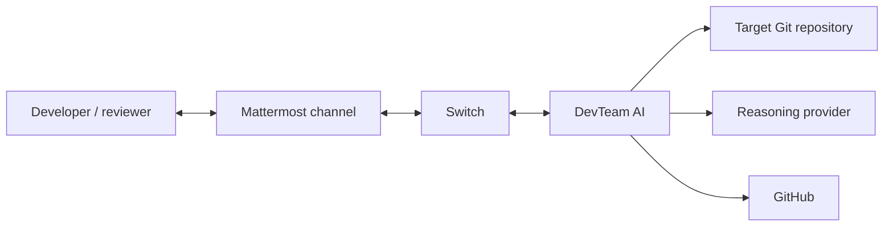
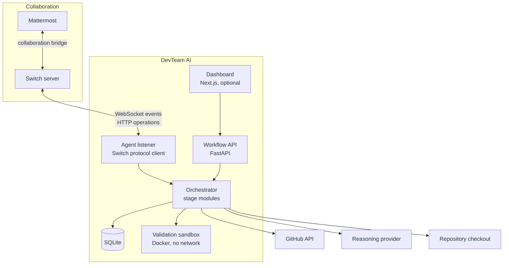
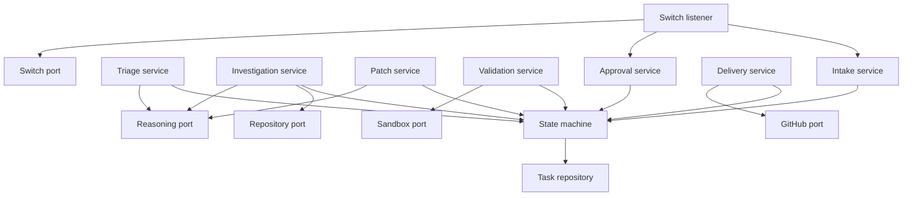
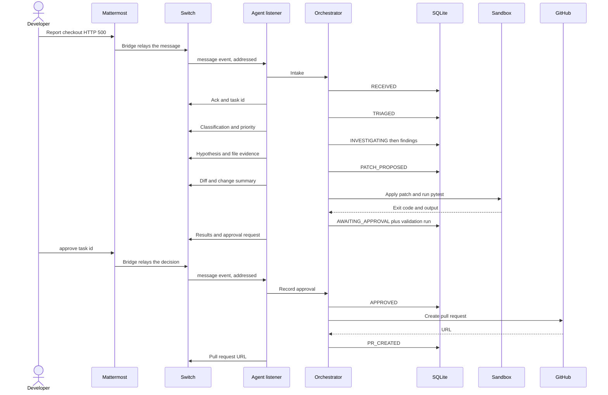

# DevTeam AI Architecture

**Product:** Collaborative Software Incident Resolution Platform  
**Source of requirements:** [ProblemStatements.md](./ProblemStatements.md)  
**Version:** 4.0  
**Status:** MVP architecture  
**Hackathon:** Flip the Switch 2026 (WeMakeDevs)

This document describes how DevTeam AI turns a developer issue in a Switch room into an evidence-backed patch, a real test run, a human approval, and an optional GitHub pull request.

**Product principle:** Collaborative AI, evidence-driven engineering, and human-controlled execution.

---

## Contents

1. [Architecture goals](#1-architecture-goals)
2. [System context](#2-system-context)
3. [Container view](#3-container-view)
4. [Component view](#4-component-view)
5. [Switch integration](#5-switch-integration)
6. [Engineering workflow](#6-engineering-workflow)
7. [Workflow state machine](#7-workflow-state-machine)
8. [Domain model](#8-domain-model)
9. [Agent design](#9-agent-design)
10. [Investigation, patch, and validation](#10-investigation-patch-and-validation)
11. [Human approval and delivery](#11-human-approval-and-delivery)
12. [HTTP API](#12-http-api)
13. [Dashboard](#13-dashboard)
14. [Security and risk controls](#14-security-and-risk-controls)
15. [Reliability and performance bounds](#15-reliability-and-performance-bounds)
16. [Repository layout](#16-repository-layout)
17. [Runtime and configuration](#17-runtime-and-configuration)
18. [Requirement mapping](#18-requirement-mapping)
19. [Demonstration walkthrough](#19-demonstration-walkthrough)
20. [Scope boundaries](#20-scope-boundaries)

---

## 1. Architecture goals

DevTeam AI is one Switch-connected engineering teammate plus a workflow service. The teammate shares a room with developers. The service owns task state, evidence, test output, and the approval gate.

The design has to satisfy four properties from the problem statement:

| Property | Architectural consequence |
|---|---|
| Collaborative execution | People and the agent meet in a Switch room. Mattermost is attached by Switch’s collaboration bridge. DevTeam AI posts and reads through the Switch agent protocol. |
| Evidence-based investigation | Findings store file paths and source excerpts taken from the repository that was actually read. |
| Verifiable engineering | Validation runs pytest (and configured checks) in an isolated workspace and stores the process output. |
| Human-controlled delivery | A pull request is created only after a persisted human approval. The delivery service checks that record on the server. |

Cursor Pro is the environment used to build this system. At runtime the product speaks the Switch agent protocol and calls a configured reasoning provider for triage, investigation synthesis, and patch drafting. Test results come from process execution.

One agent identity owns the MVP. Triage, investigation, engineering, and QA are modules behind that identity. Extra Switch agents are optional and stay off the mandatory path.

---

## 2. System context



| Actor or system | Role |
|---|---|
| Developer | Reports an issue in the shared channel: description, repository reference, error output. |
| Reviewer | The same person or another human in the room. Approves or rejects the proposal. |
| Mattermost | The chat application people type in. Switch ships with Mattermost for a local demo. |
| Switch | Room membership, durable conversation, agent identity, and the bridge into Mattermost. |
| DevTeam AI | Classifies the issue, investigates the repo, proposes a patch, runs tests, records approval, and opens a pull request after approval. |
| Target repository | The codebase under investigation. Read during investigation. Copied into a sandbox before tests. |
| Reasoning provider | Produces classification, a root-cause hypothesis, and a minimal unified diff from retrieved source. |
| GitHub | Hosts the repository and receives the pull request after approval. |

People never talk to the FastAPI process directly for the core loop. They talk in the Mattermost channel. Switch relays that channel into a room, and the agent is a member of that room.

---

## 3. Container view



| Container | Process | Responsibility | MVP |
|---|---|---|---|
| Switch | External. Local Switch plus bundled Mattermost for the demo. | Rooms, history, agent connection, Mattermost relay. | Mandatory |
| Agent listener | Python asyncio task inside the application process. | Hold one Switch WebSocket. Accept addressed messages. Post progress and results. | Mandatory |
| Workflow API | FastAPI, same process as the listener. | Typed contracts, task queries, health. Approval mutations are invoked by the listener after it has identified the human sender. | Mandatory |
| Orchestrator | Python services called by the listener. | Run the six workflow stages and the state machine. | Mandatory |
| SQLite | File database. | Tasks, events, findings, patches, validation runs, approvals, pull-request references. | Mandatory |
| Validation sandbox | Short-lived Docker container. | Apply the patch and run tests with a timeout, memory cap, and no network. | Mandatory |
| Reasoning provider | External HTTPS API. | Bounded calls for triage, hypothesis, and diff generation. | Mandatory |
| GitHub | External API. | Read the repository. Create a pull request only after approval. | Read is mandatory. Pull-request creation is P1. |
| Dashboard | Next.js. | Show task state, evidence, patch, and test output. | P1 |

The listener and the API share one deployable unit so a hackathon demo has a single process to start. Modules stay separate: the listener depends on application services, and those services do not import Switch or GitHub clients. They depend on typed ports.

---

## 4. Component view



| Component | Owns | Calls |
|---|---|---|
| Switch listener | Connection lifecycle, ping/pong, cursor resume, addressed-message filter, outbound room posts. | Intake, approval, orchestrator run, Switch port. |
| Intake | Parse a room message into a task: description, repository reference, logs. Assign a task id. | State machine. |
| Triage | Classification, priority, short task summary. | Reasoning port, state machine. |
| Investigation | Locate files, collect excerpts, write a hypothesis and uncertainties. | Repository port, reasoning port, state machine. |
| Patch | Produce a minimal unified diff, a change summary, affected files, and test suggestions. | Reasoning port, repository port, state machine. |
| Validation | Apply the diff in a sandbox, run pytest and configured checks, store the raw output. | Sandbox port, state machine. |
| Approval | Record approve or reject with reviewer identity and timestamp. Refuse delivery when no approval exists. | State machine. |
| Delivery | Open a GitHub pull request whose body includes the issue, the change, the test evidence, and the approval. Post the URL back through the listener. | GitHub port, state machine. |
| State machine | Legal transitions only. Every accepted transition appends an event. | Task repository. |
| Task repository | SQLite persistence and queries. | — |

Business rules live in the services and the state machine. Switch payloads, Git commands, Docker, and HTTP clients live behind ports in `integrations`.

### Logical responsibilities inside one agent

| Responsibility | Module | Output posted to the room |
|---|---|---|
| Triage | `Triage service` | Classification, priority, task id, one-paragraph summary. |
| Investigation | `Investigation service` | Hypothesis, file paths, evidence excerpts, uncertainties, recommended action. |
| Engineering | `Patch service` | Change summary, affected files, unified diff, suggested tests. |
| QA | `Validation service` | Commands, exit codes, captured output, pass/fail, remaining risks. |
| Human reviewer | A person in the Switch room | `approve` or `reject`. The approval service records it. |

---

## 5. Switch integration

Switch is the collaboration system. DevTeam AI uses the published agent protocol and does not open its own Mattermost connection.

Reference: [Switch agent protocol](https://docs.switchagents.ai/switch-rooms/internals/agent-protocol), [agent connection](https://docs.switchagents.ai/switch-rooms/internals/agent-connection), [agent events](https://docs.switchagents.ai/switch-rooms/internals/agent-events), [Mattermost bridge](https://docs.switchagents.ai/switch-rooms/deploy/messaging-apps/mattermost).

### How a room is formed

1. Switch is running and its Mattermost collaboration bridge is connected.
2. An agent named for this product is registered in the Switch workspace and has an API key.
3. Adding that agent’s Mattermost bot to a channel creates the room. Alternatively the room is created in Switch and Switch creates the channel.
4. Developers and the agent are members of the same room. Room instructions tell the agent to run this workflow and to wait for an explicit human approval before any pull request.

### Connection the listener keeps

| Item | Choice |
|---|---|
| Transport in | One WebSocket: `GET /agents/{agent_id}/connection/ws` |
| Transport out | `POST /agents/{agent_id}/ops/{operation}` |
| Auth | `Authorization: Bearer <agent API key>` on the socket and on every operation |
| Connection id | A stable UUID reused across reconnects |
| Scope | `single` room for the demo channel |
| Filter | `addressed`, so the agent acts on messages directed at it |
| Resume | Store the last event cursor and pass `start_from` after a drop. Reply to every ping with a pong that includes the cursor. |
| Claim | Pass the room id on the socket URL so catch-up is not skipped |

The listener acts on a `message` event only when `payload.addressed` is true. It deduplicates on `(room_id, message_id)` so a replay does not start a second task.

### Operations the MVP uses

| Operation | When |
|---|---|
| `post_message` | Acknowledgements, findings, the patch, test results, approval confirmation, the pull-request URL, and failures. |
| `read_context` | Load room instructions and recent conversation when a task starts, so the agent sees the issue thread. |
| `connect_to_room` | Used when the room is claimed after connect and the listener needs instructions, participants, and references in one response. |
| `list_participants` | Confirm the sender of an approval is a human member of the room. |
| `create_room_document` | Optional copy of the investigation summary in the room. SQLite remains the source of truth for state and approval. |

Work is handed to the human with a normal room message. The MVP does not add a second task protocol.

### Message contract inside the room

Issue intake (human, addressed to the agent):

```text
@devteam investigate
Repo: https://github.com/<owner>/<repo>
Ref: main

Checkout API returns HTTP 500 after user login.

<paste logs or stack trace>
```

`Repo` and `Ref` may also appear as a GitHub URL alone. When the repository reference is missing, the agent asks for it and leaves the task in `RECEIVED`.

Decision messages (human, addressed to the agent):

```text
@devteam approve <task_id>
@devteam reject <task_id> <reason>
@devteam cancel <task_id>
```

The listener resolves the sender from the Switch event (`sender`, `sender_name`) and passes that identity to the approval service. The dashboard cannot approve a task.

### What the agent posts

Each stage posts a short message and then the evidence. Messages include the task id so a later approval can name it.

1. Acknowledgement and task id as soon as intake persists `RECEIVED`.
2. Classification, priority, and summary after triage.
3. Hypothesis, file paths, excerpts, and uncertainties after investigation.
4. Change summary and unified diff after the patch is stored.
5. Command, exit code, and output after validation, including failures.
6. An explicit request for `approve` or `reject`.
7. The recorded decision.
8. The pull-request URL after GitHub accepts the request, or a clear failure if it does not.

---

## 6. Engineering workflow

The orchestrator runs the stages in order for one task. It posts to Switch at each boundary through a callback the listener supplies. A stage that fails records the error, moves the task to `FAILED` when retries are exhausted, and posts the failure.



| Step | Input | Persistence | Room output |
|---|---|---|---|
| 1. Intake | Description, repository, ref, logs | Task row, state `RECEIVED` | Task id |
| 2. Triage | Task description and logs | Classification, priority, summary, state `TRIAGED` | Priority and summary |
| 3. Investigation | Repository tree and error text | Findings with paths and excerpts, state `INVESTIGATING` | Hypothesis and evidence |
| 4. Patch | Findings plus relevant file text | Unified diff, summary, test suggestions, state `PATCH_PROPOSED` | Reviewable patch |
| 5. Validation | Patch and repository snapshot | Command, exit code, stdout, stderr, state `AWAITING_APPROVAL` | Actual results and risks |
| 6. Approval | Human decision message | Reviewer id, display name, timestamp, state `APPROVED` or `REJECTED` | Confirmation |
| 7. Delivery | Approved task | Pull-request URL, state `PR_CREATED` | URL |

Investigation stays on `INVESTIGATING` until a patch exists. If the repository reference cannot be resolved, or the reasoning provider cannot cite a file that was actually read, the agent posts the uncertainties and waits for a follow-up in the same task. A sandbox crash moves the task to `FAILED`. A completed test run that fails still moves to `AWAITING_APPROVAL`, with validation status `failed`, so the reviewer sees the real output.

P1 delivery can be absent. In that case `APPROVED` is the successful end of the mandatory demo, and the agent says that pull-request creation is not configured. The approval gate and the rejection of an early delivery attempt remain in place.

---

## 7. Workflow state machine

### States

| State | Meaning |
|---|---|
| `RECEIVED` | The room message is stored and has a task id. |
| `TRIAGED` | Classification, priority, and summary exist. |
| `INVESTIGATING` | Repository inspection is in progress or waiting on evidence. |
| `PATCH_PROPOSED` | A reviewable diff is stored. |
| `VALIDATING` | The sandbox is running. |
| `AWAITING_APPROVAL` | Patch and test evidence are posted. The task is waiting on a human. |
| `APPROVED` | A human approval row exists. |
| `PR_CREATED` | GitHub returned a pull-request URL. |
| `REJECTED` | A human rejected the proposal. Terminal. |
| `FAILED` | Retries or a hard error stopped the run. Terminal. |
| `CANCELLED` | A human cancelled the task. Terminal. |

### Legal transitions

| From | To | Actor | Guard |
|---|---|---|---|
| `RECEIVED` | `TRIAGED` | agent | Classification and priority are stored. |
| `TRIAGED` | `INVESTIGATING` | agent | Repository reference resolves. |
| `INVESTIGATING` | `PATCH_PROPOSED` | agent | Findings exist and every cited path was read. A diff is stored. |
| `PATCH_PROPOSED` | `VALIDATING` | agent | `git apply --check` succeeds inside the workspace. |
| `VALIDATING` | `AWAITING_APPROVAL` | agent | A validation row stores the command and the captured output. |
| `AWAITING_APPROVAL` | `APPROVED` | human | Sender is a human room member. Identity and timestamp are stored. |
| `AWAITING_APPROVAL` | `REJECTED` | human | Same identity rules. Reason is stored. |
| `APPROVED` | `PR_CREATED` | system | An approval row exists for this task. GitHub returns a URL. |
| Any non-terminal | `FAILED` | system | The stage exceeded its timeout or retry limit, or a dependency returned a hard error. |
| Any non-terminal except `APPROVED` | `CANCELLED` | human | Cancel message names the task id. |
| `APPROVED` | `FAILED` | system | GitHub delivery failed after retries. The approval row stays. |

`REJECTED`, `FAILED`, `CANCELLED`, and `PR_CREATED` have no outbound transitions. A follow-up issue creates a new task.

### Transitions the machine rejects

- Any skip, including `RECEIVED` → `PR_CREATED` and `PATCH_PROPOSED` → `APPROVED`.
- `AWAITING_APPROVAL` → `PR_CREATED`.
- `APPROVED` → `PR_CREATED` when the approval row is missing, belongs to another task, or was written by the agent identity.
- A second decision after `APPROVED` or `REJECTED`.
- An agent-sourced message that tries to approve its own task.

Every accepted transition appends a `workflow_event` with `from_state`, `to_state`, actor type, actor id, timestamp, and a JSON payload. Invalid attempts append nothing to the state, return an error to the caller, and are written to the application log with the task id. The listener posts a short refusal when a human asked for an illegal delivery.

Implementation sketch:

```python
ALLOWED: dict[TaskState, set[TaskState]] = {
    TaskState.RECEIVED: {TaskState.TRIAGED, TaskState.FAILED, TaskState.CANCELLED},
    TaskState.TRIAGED: {TaskState.INVESTIGATING, TaskState.FAILED, TaskState.CANCELLED},
    TaskState.INVESTIGATING: {TaskState.PATCH_PROPOSED, TaskState.FAILED, TaskState.CANCELLED},
    TaskState.PATCH_PROPOSED: {TaskState.VALIDATING, TaskState.FAILED, TaskState.CANCELLED},
    TaskState.VALIDATING: {TaskState.AWAITING_APPROVAL, TaskState.FAILED, TaskState.CANCELLED},
    TaskState.AWAITING_APPROVAL: {
        TaskState.APPROVED,
        TaskState.REJECTED,
        TaskState.FAILED,
        TaskState.CANCELLED,
    },
    TaskState.APPROVED: {TaskState.PR_CREATED, TaskState.FAILED},
    TaskState.PR_CREATED: set(),
    TaskState.REJECTED: set(),
    TaskState.FAILED: set(),
    TaskState.CANCELLED: set(),
}
```

`transition()` runs in a database transaction: compare current state, insert the event, update the task. Concurrent approval and cancel serialize on that row.

---

## 8. Domain model

SQLite tables match these Pydantic models. Identifiers are UUID strings. Timestamps are UTC ISO-8601.

### task

| Column | Notes |
|---|---|
| `id` | Primary key. Shown in every room message. |
| `switch_room_id` | Room that owns the conversation. |
| `origin_message_id` | Deduplication key with the room id. |
| `repository` | `owner/name` or a local demo path. |
| `git_ref` | Branch, tag, or commit. Default `main`. |
| `title` | Short title taken from the first line of the issue. |
| `description` | Full issue text. |
| `logs` | Pasted stack trace or error output. |
| `classification` | Example: `bug`, `regression`, `test_failure`, `config`. Null until triage. |
| `priority` | `critical`, `high`, `medium`, `low`. Null until triage. |
| `summary` | Triage summary. |
| `state` | Current state. |
| `created_at`, `updated_at` | |

One active task per room is enough for the MVP. A new addressed issue while a task is non-terminal gets a reply that names the active task id and asks the sender to cancel or wait.

### workflow_event

| Column | Notes |
|---|---|
| `id` | |
| `task_id` | |
| `from_state`, `to_state` | |
| `actor_type` | `human`, `agent`, or `system`. |
| `actor_id` | Switch user id or the agent id. |
| `actor_name` | Display name at the time of the event. |
| `payload` | JSON. Stage-specific details. |
| `created_at` | |

### finding

| Column | Notes |
|---|---|
| `id`, `task_id` | |
| `hypothesis` | Root-cause statement. |
| `summary` | Investigation summary. |
| `recommended_action` | What the patch should change. |
| `uncertainties` | Missing evidence, as text. |
| `created_at` | |

### finding_evidence

| Column | Notes |
|---|---|
| `id`, `finding_id` | |
| `path` | Repository-relative path. |
| `start_line`, `end_line` | |
| `excerpt` | The lines that were read. |
| `reason` | Why this excerpt supports the hypothesis. |

### patch

| Column | Notes |
|---|---|
| `id`, `task_id` | One current patch per task. |
| `diff` | Unified diff. |
| `summary` | What changed and why. |
| `affected_files` | JSON list of paths. |
| `test_recommendations` | JSON list of test names or commands. |
| `created_at` | |

### validation_run

| Column | Notes |
|---|---|
| `id`, `task_id` | |
| `command` | Exact argv, for example `pytest -q tests/test_checkout.py`. |
| `exit_code` | Null only if the process was killed before exit. |
| `stdout`, `stderr` | Captured bytes decoded as UTF-8 with replacement. |
| `status` | `passed`, `failed`, or `error`. |
| `risks` | Text. Includes failing tests and anything not executed. |
| `started_at`, `finished_at` | |

`passed` means exit code 0. `failed` means the test process exited non-zero. `error` means the sandbox itself failed. An `error` run follows the `FAILED` transition. A `failed` or `passed` run follows `AWAITING_APPROVAL`.

### approval

| Column | Notes |
|---|---|
| `id`, `task_id` | Unique on `task_id`. |
| `decision` | `approved` or `rejected`. |
| `reviewer_id`, `reviewer_name` | From the Switch event. |
| `switch_message_id` | The decision message. |
| `reason` | Required for rejection. Optional for approval. |
| `created_at` | |

### pull_request

| Column | Notes |
|---|---|
| `id`, `task_id` | Unique on `task_id`. |
| `url`, `number` | Returned by GitHub. |
| `head_branch` | Branch created for the patch. |
| `base_ref` | The task’s `git_ref`. |
| `created_at` | |

---

## 9. Agent design

### Listener loop

```text
open WebSocket
on connection_state: store generation and cursor
on ping: pong with cursor
on message if addressed and not seen:
    if body is approve | reject | cancel:
        approval or cancel service
    else:
        intake, then run stages until AWAITING_APPROVAL, FAILED, or a wait for more evidence
on socket drop:
    reconnect with the same connection_id and start_from cursor
```

Stages after intake run as a background task on the same event loop so the socket keeps answering pings. A per-task lock prevents two stages from transitioning the same row.

### Reasoning calls

The reasoning port has three methods. Each method receives structured input and must return a Pydantic model.

| Call | Input | Output | Bound |
|---|---|---|---|
| `classify` | Description and logs | `classification`, `priority`, `summary` | One call, one retry |
| `hypothesize` | Description, logs, and retrieved excerpts only | Hypothesis, cited evidence ids, uncertainties, recommended action | One call, one retry |
| `propose_patch` | Hypothesis, excerpts, and test file hints | Unified diff, summary, affected files, test commands | One call, one retry |

The investigation service retrieves files before `hypothesize`. The model is instructed to cite only those excerpts. The service drops any citation whose path was not in the retrieval set, and it records that drop as an uncertainty. A hypothesis with zero surviving citations does not advance to `PATCH_PROPOSED`.

`propose_patch` must return a unified diff that touches only paths inside the repository. The patch service rejects diffs that:

- use absolute paths or `..`
- create or modify files outside the checkout
- exceed a size limit (default 400 lines)
- are empty

### Prompts stay narrow

Each call asks for one artifact. The patch call receives the hypothesis and the file bodies it is allowed to edit. It does not receive the whole repository. Validation does not call the model to interpret test output. The room message quotes the stored stdout and stderr.

### Future extra agents

A later split can register more Switch agents and pass work with `send_targeted_message` or a mention. The state machine stays in this service, which remains the only component allowed to approve delivery. The single-agent path has to keep working if those agents are absent.

---

## 10. Investigation, patch, and validation

### Repository port

| Method | Behavior |
|---|---|
| `resolve(repository, git_ref)` | Confirm the ref exists. Use a read-only GitHub token, or a local path when the demo repo is on disk. |
| `search(query)` | Search file contents for exception types, route paths, and function names taken from the logs. |
| `read(path, start, end)` | Return numbered lines. Record the read. |
| `tree()` | List tracked files, capped, so the model is not given the entire tree in a prompt. |

Retrieval order for an issue:

1. Parse stack frames and HTTP route strings from the logs.
2. Search for those symbols.
3. Read the matching functions and their direct callers or tests, with a file cap (default 8 files).
4. Pass those excerpts to `hypothesize`.

The checkout used for reading is a normal clone or a local working copy. It is separate from the sandbox copy used to apply the patch.

### Sandbox port

The validation service builds a fresh workspace:

1. Copy or clone `git_ref` into an empty directory.
2. Write the diff and run `git apply --check`, then `git apply`.
3. Start a container from a pinned image that already contains the demo project’s test dependencies, or install them from the lockfile with a time budget.

Container constraints:

| Control | Default |
|---|---|
| Network | `none` |
| Memory | 512 MB |
| CPUs | 1 |
| Process timeout | 120 seconds |
| Filesystem | The workspace is the only writable mount. |
| User | Non-root user inside the container. |

The service stores `command`, `exit_code`, `stdout`, and `stderr` from the process it spawned. It does not rewrite a non-zero exit into a pass.

Default command:

```text
pytest -q
```

When the patch recommendation names a file, that file is appended. A configured quality command (Ruff on the touched paths) may run as a second `validation_run` row. Pytest is the run that decides `passed` versus `failed`.

### Patch application before anyone is asked to approve

`PATCH_PROPOSED` → `VALIDATING` happens only after `git apply --check` succeeds. A diff that does not apply becomes `FAILED` with the apply output stored in the event payload and posted to the room.

---

## 11. Human approval and delivery

### Approval service

`decide(task_id, decision, reviewer)`:

1. Load the task. The state must be `AWAITING_APPROVAL`.
2. Reject the call when `reviewer.id` equals the agent id.
3. Reject the call when the reviewer is not a human participant in the task’s room. The listener supplies the participant list it read from Switch.
4. Insert the `approval` row and transition to `APPROVED` or `REJECTED` in one transaction.
5. Return the new state. On `APPROVED`, the orchestrator may start delivery. On `REJECTED`, the listener posts the reason and stops.

There is no approval method that omits the reviewer. Unit tests cover a missing reviewer, an agent reviewer, a wrong state, and a repeated decision.

### Delivery service

`create_pull_request(task_id)`:

1. Load the task, the approval, the patch, the findings, and the validation runs.
2. Require `state == APPROVED` and `approval.decision == approved`.
3. Create a branch `devteam/<task_id>` from `git_ref`.
4. Commit the applied patch with a message that includes the task id.
5. Open a pull request into `git_ref`.
6. Store the URL and transition to `PR_CREATED`.
7. Return the URL to the listener.

The pull-request body contains:

- Issue title and description
- Hypothesis and evidence paths
- Change summary
- Test command, exit code, and a bounded excerpt of the real output
- Reviewer name, reviewer id, and approval timestamp
- Link back to the task id

The delivery token is a separate GitHub credential from the read token. The delivery module is the only importer of the write client. Calling it from any state other than `APPROVED` raises `ApprovalRequired` before any GitHub write request.

A demonstration of criterion 9 calls `create_pull_request` while the task is `AWAITING_APPROVAL` and shows the refusal in the test output and, if triggered from the room, in the room transcript.

Production deployment of the patched service is outside this system. Delivery stops at the pull request.

---

## 12. HTTP API

The API is the typed edge for the dashboard, health checks, and automated tests. Pydantic models are the contracts. The listener calls the same services in-process. It does not loop back through HTTP.

Base path: `/api/v1`

| Method | Path | Behavior | Auth |
|---|---|---|---|
| `GET` | `/health` | Liveness of the API process. | None |
| `GET` | `/tasks` | List tasks for the configured room, newest first. | Dashboard token |
| `GET` | `/tasks/{id}` | Task, current state, summary. | Dashboard token |
| `GET` | `/tasks/{id}/events` | Transition history. | Dashboard token |
| `GET` | `/tasks/{id}/findings` | Hypothesis and evidence. | Dashboard token |
| `GET` | `/tasks/{id}/patch` | Diff and summary. | Dashboard token |
| `GET` | `/tasks/{id}/validation` | Runs with stdout and stderr. | Dashboard token |
| `GET` | `/tasks/{id}/approval` | Decision record, or empty. | Dashboard token |

Approval, rejection, intake, and pull-request creation are not public routes. Tests call the services directly. That keeps a stolen dashboard token from authorizing delivery.

Errors use a single body: `{"error": {"code": "...", "message": "...", "task_id": "..."}}`. Codes include `invalid_transition`, `approval_required`, `task_not_found`, and `not_addressed`.

---

## 13. Dashboard

The dashboard is P1. The mandatory demo is complete when the Switch room shows the workflow.

| Route | Shows |
|---|---|
| `/` | Tasks in the room: id, title, priority, state, updated time. |
| `/tasks/[id]` | Timeline of events, findings with paths, diff, validation output, approval, pull-request URL. |

The UI is Next.js, TypeScript, and Tailwind CSS. It polls `GET /api/v1/tasks/{id}` every few seconds while a task is non-terminal. It renders stdout as stored. It has no approve button.

Empty, missing, and failed tasks each have a visible state: no tasks yet, unknown id, and a `FAILED` banner that includes the last event payload.

---

## 14. Security and risk controls

| Risk | Control in this design |
|---|---|
| Incorrect code proposals | The diff is posted in the room. Tests run before approval. A human must approve. |
| Untrusted repository code | Pytest runs in a network-none, non-root, memory-capped container. The workspace is a copy. |
| Credential exposure | Secrets come from the environment. The read token and the delivery token are different. Logs redact token values. `.env` stays untracked. An example file lists names only. |
| Agent execution failure | Per-stage timeouts. One retry for reasoning calls and for GitHub writes. The task ends in `FAILED` with the error posted. |
| Unauthorized code delivery | `create_pull_request` checks the approval row on the server. The agent cannot approve itself. The dashboard cannot approve. |
| Incorrect test reporting | The validation row stores the command, exit code, and captured streams. The room message quotes those fields. |
| Invalid workflow transitions | The state machine is the only writer of `task.state`. |
| Prompt injection in issue text or repository files | Retrieved file text is data for the reasoning calls. Tool rights stay in the orchestrator. A model response cannot transition state or call GitHub except through schema-validated service methods. |
| Path escape in a generated diff | The patch service rejects absolute paths and `..` before apply. |

Switch API keys and GitHub tokens are agent-scoped and repository-scoped. The GitHub delivery token’s repository permission is pull-request creation on the demo repository.

---

## 15. Reliability and performance bounds

| Bound | Value |
|---|---|
| Reasoning calls per task | At most 3 successful calls (classify, hypothesize, propose), plus one retry each. |
| Stage timeout | 60 seconds for reasoning and GitHub reads. 120 seconds for the sandbox. 30 seconds for pull-request creation. |
| Retries | One retry with jitter for network errors. No retry after an invalid model schema. |
| Room concurrency | One active task. |
| Switch resume | Reconnect with the same `connection_id` and cursor. Deduplicate `message_id`. |
| History | SQLite file on a volume so a process restart keeps tasks and approvals. |
| Logging | Structured logs: `task_id`, `state`, `actor`, `stage`, `duration_ms`, `error`. |

A restart while a task is `VALIDATING` marks that run `error` if no exit was stored, then moves the task to `FAILED` with reason `interrupted`. The operator can ask the agent to investigate again, which creates a new task. This avoids a half-applied sandbox being described as a pass.

---

## 16. Repository layout

```text
devteam-ai/
  docs/
    ProblemStatements.md
    architecture.md
  backend/
    pyproject.toml
    app/
      main.py                      # FastAPI app and listener startup
      api/
        routes.py
        schemas.py                 # Pydantic response models
      domain/
        states.py                  # enum and ALLOWED transitions
        models.py
        errors.py
      services/
        intake.py
        triage.py
        investigation.py
        patch.py
        validation.py
        approval.py
        delivery.py
        orchestrator.py
      ports.py                     # Protocols for Switch, repo, sandbox, GitHub, reasoning
      integrations/
        switch_client.py
        repository.py
        sandbox.py
        github.py
        reasoning.py
      persistence/
        db.py
        repository.py
      agent/
        listener.py
        parser.py                  # issue text and approve/reject/cancel
    tests/
      test_state_machine.py
      test_approval_gate.py
      test_patch_safety.py
      test_validation_capture.py
  frontend/                        # P1 Next.js app
  demo-repo/                       # checkout service used in the scripted demo
  docker-compose.yml
  Dockerfile
  .env.example
  README.md
```

`domain` does not import FastAPI, httpx, or Docker. `services` import ports and domain types. `integrations` implement the ports.

---

## 17. Runtime and configuration

### Processes

`docker compose up` starts:

| Service | Image | Purpose |
|---|---|---|
| `app` | This repository’s Dockerfile | FastAPI, listener, SQLite on a volume. |
| `sandbox` | Built from the demo repo’s test image | Invoked per run with `docker run --rm`. The app container’s Docker socket is limited to that usage for the demo. |

Switch and Mattermost are started with the documented Switch Console or Switch server flow, not reimplemented here. The app receives `SWITCH_BASE_URL` pointing at that server.

### Environment

```text
SWITCH_BASE_URL=
SWITCH_AGENT_ID=
SWITCH_AGENT_API_KEY=
SWITCH_ROOM_ID=
SWITCH_CONNECTION_ID=

GITHUB_REPO=owner/name
GITHUB_READ_TOKEN=
GITHUB_DELIVERY_TOKEN=

REASONING_BASE_URL=
REASONING_API_KEY=
REASONING_MODEL=

DATABASE_PATH=/data/devteam.db
SANDBOX_IMAGE=devteam-sandbox:demo
SANDBOX_TIMEOUT_SECONDS=120
DASHBOARD_TOKEN=
```

`.env.example` ships those names with empty values. The delivery token may be empty when pull-request creation is disabled. The approval gate still runs.

### Quality gates for this repository

| Tool | Use |
|---|---|
| Pytest | State machine, approval gate, diff path checks, validation parsing. |
| Ruff | Lint. |
| Mypy | Type check on `app`. |
| Docker | Run the app and the sandbox the way the demo runs them. |

---

## 18. Requirement mapping

| ID | Priority | Where it lives |
|---|---|---|
| FR-01 | P0 | Agent listener and Switch connection. |
| FR-02 | P0 | Addressed `message` events in the configured room. |
| FR-03 | P0 | Triage service. State `TRIAGED`. |
| FR-04 | P0 | Repository port and investigation service. |
| FR-05 | P0 | `finding` and `finding_evidence`. |
| FR-06 | P0 | Patch service. State `PATCH_PROPOSED`. |
| FR-07 | P0 | Sandbox port. |
| FR-08 | P0 | `validation_run` stdout, stderr, exit code. |
| FR-09 | P0 | `post_message` after each stage. |
| FR-10 | P0 | Approval service. Delivery guard. |
| FR-11 | P1 | `workflow_event` history. Included in the MVP schema because the state machine needs it. The richer analytics view is P1. |
| FR-12 | P1 | Delivery service and GitHub write token. |
| FR-13 | P1 | Next.js dashboard, read-only. |

Acceptance criteria map onto the same path: room communication (1), intake (2), triage plus investigation (3–5), patch (6), real pytest (7), human decision (8), server-side refusal (9), and the event log plus this setup (10).

---

## 19. Demonstration walkthrough

**Use case:** Checkout API returns HTTP 500 after user login.

The demo repository contains a checkout handler that assumes a session field set at login and raises when that field is missing. A regression test fails before the patch and passes after it. The agent does not receive the answer in its prompt. It receives the issue text and has to read the repository.

| # | What the audience sees | What the system did |
|---|---|---|
| 1 | Developer posts the issue in Mattermost, mentioning the agent. | Switch delivers an addressed `message`. |
| 2 | Agent replies with a task id. | Intake stored `RECEIVED`. |
| 3 | Agent posts classification and priority. | Triage stored `TRIAGED`. |
| 4 | Agent names the checkout and login files. | Investigation read those files. |
| 5 | Agent states a hypothesis and quotes the lines. | Evidence rows match the quote. |
| 6 | Agent posts a small diff. | Patch stored. Apply check passed. |
| 7 | Agent runs pytest. | Sandbox container exit code and output stored. |
| 8 | The room shows the real pytest transcript. | Message body is the stored output. |
| 9 | Developer replies `approve <task_id>` or `reject <task_id>`. | Approval row and state change. |
| 10 | On approval, the room receives a GitHub URL. | Delivery ran only after `APPROVED`. |

Before step 9, a scripted call to the delivery service shows `ApprovalRequired` and leaves GitHub unchanged. That is the unauthorized-delivery check.

The recording uses the setup in the README: Switch, Mattermost, the app container, the sandbox image, and the demo repository.

---

## 20. Scope boundaries

**In the mandatory path:** Switch room, one agent, intake, investigation with file evidence, a minimal patch, a real pytest run, human approval, trace stored in SQLite.

**Optional, same architecture:** GitHub pull-request creation, the read-only Next.js dashboard, extra charts over `workflow_event`, additional Switch agents that still pass through this state machine.

**Outside the system:** Kubernetes, model training, multi-tenant hosting, production deploys, and a second chat integration. Slack, Teams, Discord, and Telegram can already appear as Switch bridges. This product adds none of them itself.

---

**Product principle:** Collaborative AI, evidence-driven engineering, and human-controlled execution.
