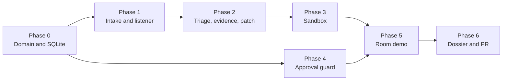

# Implementation Plan — DevTeam AI

**Product:** Collaborative Software Incident Resolution Platform  
**Sources:** [architecture.md](./architecture.md), [ProblemStatements.md](./ProblemStatements.md)  
**Frontend:** [stitch_devteamai](../stitch_devteamai) — DevTeam Dossier (`DESIGN.md` and the six screens)  
**Scorecard:** [eval.md](./eval.md) — a phase is done when its exit tests pass. Those tests are the entry ticket for the matching gate.  
**Version:** 4.1  
**Status:** Build sequence for the MVP  
**Hackathon:** Flip the Switch 2026 (WeMakeDevs)

This plan turns the architecture into a build order. Each phase ends with a working slice and named tests. Later phases call the services from the earlier ones. They do not reopen a closed rule.

**Product principle:** Collaborative AI, evidence-driven engineering, and human-controlled execution.

---

## Contents

1. [How to use this plan](#1-how-to-use-this-plan)
2. [Phase map](#2-phase-map)
3. [Phase 0 — Domain and persistence](#3-phase-0--domain-and-persistence)
4. [Phase 1 — Intake and Switch listener](#4-phase-1--intake-and-switch-listener)
5. [Phase 2 — Triage, investigation, and patch](#5-phase-2--triage-investigation-and-patch)
6. [Phase 3 — Validation sandbox](#6-phase-3--validation-sandbox)
7. [Phase 4 — Approval and delivery guard](#7-phase-4--approval-and-delivery-guard)
8. [Phase 5 — Orchestrator and live demonstration](#8-phase-5--orchestrator-and-live-demonstration)
9. [Phase 6 — Dossier and pull request](#9-phase-6--dossier-and-pull-request)
10. [Controls that travel with the phase](#10-controls-that-travel-with-the-phase)
11. [Demonstration and submission](#11-demonstration-and-submission)

---

## 1. How to use this plan

Build phases in order. Phase 0 is the base. Phases 1 through 5 are the mandatory path (Problem Statements §12, acceptance criteria 1–10). Phase 6 is optional (FR-12 live delivery and FR-13). An empty delivery token is a valid end of the mandatory demo: the room says pull-request creation is not configured, and `APPROVED` is the last successful state.

Rules that apply in every phase:

- `domain` does not import FastAPI, httpx, or Docker. `services` depend on ports and domain types. `integrations` implement the ports (architecture §4, §16).
- The state machine is the only writer of `task.state` (architecture §7, §14).
- A model response cannot change state, mark a test as passed, or call GitHub. Those decisions stay in services after schema validation (architecture §9, §14).
- Fail closed. A missing citation, an unsafe diff, a sandbox error, or a missing approval stops the run. The service does not invent a diagnosis, a diff, or a passing result.
- One active task per room. A second addressed issue names the active task id and asks the sender to cancel or wait (architecture §8).
- Secrets come from the environment. `.env` stays untracked. `.env.example` lists names only (architecture §17).

The repository layout in architecture §16 is the target tree. Create a module in the phase that first needs it. Do not stub a later phase’s behavior inside an earlier one.

### Current baseline

Phase 0 is already in the tree: `backend/app/domain/` (states, models, errors, paths), `backend/app/persistence/` (schema and `StateMachine`), and `backend/tests/test_state_machine.py`. Later phases start from that package. They add `ports.py`, `services/`, `integrations/`, `agent/`, `api/`, and `main.py` as each phase names them.

---

## 2. Phase map



Phase 4 does not need Docker. It can be built beside Phase 3 once Phase 0 is green. Phase 5 waits for both.

| Phase | Gate | Priority | Requirements | Acceptance | Exit tests |
|---|---|---|---|---|---|
| 0 | G0 | P0 | State machine; event rows the machine needs | Trace shape for criterion 10 | `test_state_machine.py` |
| 1 | G1 | P0 | FR-01, FR-02 | 1, 2 (unit level) | `test_intake_parser.py`, `test_listener_filter.py`, `test_listener_resume.py` |
| 2 | G2 | P0 | FR-03, FR-04, FR-05, FR-06 | 3, 4, 5, 6 (unit level) | `test_investigation_evidence.py`, `test_patch_safety.py`, `test_reasoning_bounds.py` |
| 3 | G3 | P0 | FR-07, FR-08 | 7 | `test_validation_capture.py`, then one live image |
| 4 | G4 | P0 guard; P1 write | FR-10; FR-12 guard | 8 (service), 9 | `test_approval_gate.py`, `test_delivery.py` |
| 5 | G5 | P0 | FR-09; reproducible demo | 1–10 in a room | `test_restart.py`; scenarios A and F observed |
| 6 | G6 | P1 | FR-11 view, FR-12 live, FR-13 | Optional O1, O2 | `test_api_dashboard.py`; dossier screens in `frontend/` (`npm run build`, component tests); a real pull request only with a delivery token |

Unit tests in Phases 1–4 use fakes for Switch, the reasoning provider, Docker, and GitHub. A green unit test does not count as a live room, a live container, or a real pull request. Those claims wait for Phases 3 (container), 5 (room), and 6 (GitHub write). A green `test_api_dashboard.py` does not count as the dossier. O2 is the Next.js screens in Track A, checked against the Stitch reference.

---

## 3. Phase 0 — Domain and persistence

**Goal.** Legal workflow history in SQLite, with typed contracts the later services share.

**Architecture.** §7, §8, §16 (`domain/`, `persistence/`).  
**Problem statement.** §9 (states, actors, rejected transitions, authorization before a pull request).

### Build

| Piece | Location | Behavior |
|---|---|---|
| States and `ALLOWED` | `app/domain/states.py` | The eleven states and the transition table in architecture §7. Terminal states have no outbound edge. |
| Models | `app/domain/models.py` | Pydantic models for task, event, finding, evidence, patch, validation run, approval, pull request. UUID strings. UTC timestamps. |
| Errors | `app/domain/errors.py` | `invalid_transition`, `approval_required`, `task_not_found`. |
| Path check | `app/domain/paths.py` | Repository-relative paths. Reject absolute paths and `..`. |
| Schema | `app/persistence/db.py` | Tables in architecture §8, including unique `(switch_room_id, origin_message_id)` and unique approval and pull request per task. |
| Machine | `app/persistence/repository.py` | `transition()` in one transaction: compare current state, insert `workflow_event`, update the task. Concurrent approval and cancel serialize on the row. |

`workflow_event` is stored in this phase because the machine needs it (architecture §18, FR-11). Charts over that history wait for Phase 6.

### Rules

- A skip such as `RECEIVED` → `PR_CREATED` or `PATCH_PROPOSED` → `APPROVED` writes nothing and raises `invalid_transition`.
- `AWAITING_APPROVAL` → `PR_CREATED` is illegal.
- `APPROVED` → `PR_CREATED` requires an approval row for this task whose reviewer is not the agent. The check’s caller is Phase 4; the machine must already refuse a missing or agent-written approval.
- A second decision after `APPROVED` or `REJECTED` is rejected.
- Invalid attempts are logged with the task id. They do not append an event.
- `APPROVED` may go to `FAILED` when delivery fails later. The approval row stays. Cancel is refused once the task is `APPROVED`.

### Exit

`backend/tests/test_state_machine.py` passes: happy path, every illegal skip, actor mismatch, missing approval, repeated decision, and a concurrent approval versus cancel.

**Not in this phase.** HTTP routes, Switch, reasoning calls, Docker, GitHub.

---

## 4. Phase 1 — Intake and Switch listener

**Goal.** An addressed room message becomes one task, or a decision command, and the socket can resume after a drop.

**Architecture.** §5, §6 step 1, §9 listener loop, §16 (`agent/`, `ports.py`).  
**Problem statement.** FR-01, FR-02. Acceptance 1 and 2 at unit level. Live Mattermost is Phase 5.

### Build

| Piece | Location | Behavior |
|---|---|---|
| Ports | `app/ports.py` | Protocols for Switch, repository, sandbox, GitHub, and reasoning. This phase implements only the Switch port in tests, with a fake. |
| Parser | `app/agent/parser.py` | Issue text and `approve` / `reject` / `cancel`. Commands are the first token after the mention. |
| Intake | `app/services/intake.py` | Persist `RECEIVED` with description, repository, ref, and logs. Assign the task id. Missing repository leaves the task in `RECEIVED` and asks for it. |
| Listener | `app/agent/listener.py` | One WebSocket. Ping replies with the cursor. Act only when `payload.addressed` is true. Deduplicate `(room_id, message_id)`. Dispatch commands to approval or cancel once those services exist; until Phase 4, command parsing is tested against a fake decider. |
| Switch client | `app/integrations/switch_client.py` | Bearer auth, `post_message`, `read_context`, `connect_to_room`, `list_participants`. Reconnect with the same `connection_id` and `start_from` cursor. |

Message shapes are the contract in architecture §5:

```text
@devteam investigate
Repo: https://github.com/<owner>/<repo>
Ref: main

Checkout API returns HTTP 500 after user login.

<paste logs or stack trace>
```

```text
@devteam approve <task_id>
@devteam reject <task_id> <reason>
@devteam cancel <task_id>
```

`Repo` and `Ref` may be a GitHub URL alone. Default ref is `main`.

### Rules

- Unaddressed messages and the agent’s own posts create no task and no decision.
- A replayed `(room_id, message_id)` does not start a second task or a second approval.
- A missing task id, a reject with no reason, a mid-sentence “approve”, or a non-ASCII lookalike does not decide.
- A new issue while a task is non-terminal replies with the active task id. It does not create another row.
- The listener posts the task id as soon as intake commits `RECEIVED`. Stage posts after triage wait for Phase 2 and the orchestrator in Phase 5.
- Stages after intake run as a background task so the socket keeps answering pings. A per-task lock prevents two stages from transitioning the same row. The lock is introduced with the listener even if the only stage so far is intake.

### Exit

| Test | Proves |
|---|---|
| `test_intake_parser.py` | Issue fields, missing repo stays `RECEIVED`, command shape, one active task. |
| `test_listener_filter.py` | Addressed-only handling, self-post ignore, dedup. |
| `test_listener_resume.py` | Same connection id, cursor on pong, `start_from` after a drop. |

**Not in this phase.** Classification, file reads, diffs, pytest, approval writes, pull requests. A live Switch room is Phase 5. This phase’s client is covered with a fake transport.

---

## 5. Phase 2 — Triage, investigation, and patch

**Goal.** A received issue becomes a classification, a hypothesis that cites files actually read, and one reviewable unified diff.

**Architecture.** §6 steps 2–4, §9 reasoning calls, §10 repository port.  
**Problem statement.** FR-03, FR-04, FR-05, FR-06. Workflow steps 1–3. Acceptance 3–6 at unit level.

### Build

| Piece | Location | Behavior |
|---|---|---|
| Reasoning | `app/integrations/reasoning.py` | `classify`, `hypothesize`, `propose_patch`. Each returns a Pydantic model. One call and one retry. No retry after an invalid schema. |
| Repository | `app/integrations/repository.py` | `resolve`, `search`, `read`, `tree`. Read-only token, or a local path for the demo checkout. Record every read. |
| Triage | `app/services/triage.py` | Store classification, priority (`critical`, `high`, `medium`, `low`), and summary. Transition `RECEIVED` → `TRIAGED`. |
| Investigation | `app/services/investigation.py` | Parse stack frames and route strings, search, read at most 8 files, call `hypothesize` with those excerpts only. |
| Patch | `app/services/patch.py` | Call `propose_patch` with the hypothesis and the file bodies it may edit. Store one diff, summary, affected files, and test suggestions. |

Retrieval order is architecture §10: frames and routes, then search, then the matching functions and their direct callers or tests, then `hypothesize`. The checkout used for reading is separate from the sandbox copy in Phase 3.

### Rules

- The model may cite only excerpts that were retrieved. Drop any other citation and record the drop as an uncertainty.
- A hypothesis with zero surviving citations stays `INVESTIGATING`. `propose_patch` is not called.
- `TRIAGED` → `INVESTIGATING` only when the repository reference resolves.
- `INVESTIGATING` → `PATCH_PROPOSED` only when findings exist, every cited path was read, and a diff is stored.
- Reject a diff that uses an absolute path or `..`, touches a path outside the checkout, exceeds 400 lines, or is empty. Those end as `FAILED` with `unsafe_diff` or `invalid_diff`. No container starts.
- Each reasoning method asks for one artifact. The patch call does not receive the whole repository.
- Prompts for the checkout demo contain the issue text and the retrieved excerpts. They do not contain the root cause or the patch.
- At most three successful reasoning calls per task (classify, hypothesize, propose), plus one retry each. Stage timeout for a reasoning or GitHub read is 60 seconds.

### Exit

| Test | Proves |
|---|---|
| `test_investigation_evidence.py` | Reads are recorded. Foreign paths and a search miss do not reach `PATCH_PROPOSED`. The stored excerpt is the quote. |
| `test_patch_safety.py` | Traversal, empty, oversize, and out-of-tree diffs are refused before apply. |
| `test_reasoning_bounds.py` | Invalid schema is not retried and invents nothing. A replayed room post does not call the provider again. |

**Not in this phase.** `git apply`, pytest, approval, room transcripts of the full workflow. Wire the three services so a later orchestrator can call them in order. Posting every stage to Switch is Phase 5, through a callback the listener supplies.

---

## 6. Phase 3 — Validation sandbox

**Goal.** The stored diff is applied in a fresh workspace and pytest’s real exit code and streams are stored.

**Architecture.** §6 step 5, §10 sandbox port, §15 bounds.  
**Problem statement.** FR-07, FR-08. Workflow step 4. Acceptance 7.

### Build

| Piece | Location | Behavior |
|---|---|---|
| Sandbox | `app/integrations/sandbox.py` | The only module that starts a container. |
| Validation | `app/services/validation.py` | Copy or clone `git_ref`, `git apply --check`, `git apply`, run pytest, store the row. |

Workspace sequence:

1. Copy or clone `git_ref` into an empty directory, separate from the investigation checkout.
2. `git apply --check`, then `git apply`. A diff that does not apply becomes `FAILED`. The apply output is stored on the event and is available for the room post.
3. Run the container. Default command is `pytest -q`. When the patch names a test file, append that file. Shell metacharacters in a suggested command become `pytest -q`.
4. Optional second `validation_run` for a configured quality check such as Ruff on touched paths. Pytest is the run that chooses `passed` or `failed`.

Container defaults: network `none`, 512 MB memory, 1 CPU, 120 second timeout, workspace as the only writable mount, non-root user, pinned image `SANDBOX_IMAGE`.

Status mapping:

| Outcome | `validation_run.status` | Next state |
|---|---|---|
| Exit code 0 | `passed` | `AWAITING_APPROVAL` |
| Pytest exits non-zero, including no tests collected | `failed` | `AWAITING_APPROVAL` |
| Timeout, missing engine, or no exit stored | `error` | `FAILED` |

A finished failing suite is not hidden as `FAILED`. `FAILED` is for the sandbox itself, an apply failure, or an exhausted retry.

### Rules

- The service stores `command`, `exit_code`, `stdout`, and `stderr`. It does not rewrite a non-zero exit into a pass, and it does not ask the model to interpret the output.
- Host pytest does not run as a fallback when Docker is down.
- Cancel during `VALIDATING` kills the container, stores `error`, and moves to `CANCELLED`.
- On process start, a `VALIDATING` task with no stored exit is marked `error` and `FAILED` with reason `interrupted`. That recovery test is `test_restart.py` and is finished in Phase 5 once startup exists. This phase must leave the validation row in a shape that recovery can read.
- Delivery later commits the stored diff, not the sandbox tree. The sandbox directory is disposable.

### Exit

| Test | Class | Proves |
|---|---|---|
| `test_validation_capture.py` | Unit, fake process | Status mapping, command sanitizing, apply failure does not start a container, streams stored as captured. |
| One live image | Docker | Exit 0 is `passed`. A non-zero pytest exit is `failed` and still reaches `AWAITING_APPROVAL`. A timeout kill is `error` and `FAILED`. The container has no network and no Docker socket. |

**Not in this phase.** The human decision, GitHub, and the Mattermost transcript. The service returns the stored run so Phase 5 can quote it.

---

## 7. Phase 4 — Approval and delivery guard

**Goal.** A human room member can approve or reject, and no pull request is created without that row.

**Architecture.** §6 steps 6–7, §11, §12 (no public decision routes).  
**Problem statement.** FR-10. FR-12’s guard is mandatory even when the write token is empty. Acceptance 8 at the service, and 9.

### Build

| Piece | Location | Behavior |
|---|---|---|
| Approval | `app/services/approval.py` | `decide(task_id, decision, reviewer)`. |
| Delivery | `app/services/delivery.py` | `create_pull_request(task_id)`. The only importer of the GitHub write client. |
| GitHub | `app/integrations/github.py` | Read client and write client are separate. Tests use a fake write client that records whether any HTTP call was made. |

`decide`:

1. State must be `AWAITING_APPROVAL`.
2. Reject when `reviewer.id` equals the agent id.
3. Reject when the reviewer is not a human participant in the task’s room. The listener supplies the participant list from Switch.
4. Insert `approval` and transition to `APPROVED` or `REJECTED` in one transaction. Rejection requires a reason.
5. On `APPROVED`, the orchestrator may start delivery. On `REJECTED`, stop. There is no second decision.

`create_pull_request`:

1. Load task, approval, patch, findings, and validation runs.
2. Require `state == APPROVED` and `approval.decision == approved`, and a reviewer who is not the agent. Otherwise raise `approval_required` before any GitHub write.
3. When `GITHUB_DELIVERY_TOKEN` is empty, do not call GitHub. Return a configured-off result the listener can post. The approval row stays.
4. When the token is set: branch `devteam/<task_id>` from `git_ref`, commit the stored patch with the task id in the message, open a pull request into `git_ref`, store URL and number, transition to `PR_CREATED`. Timeout 30 seconds, one retry on network errors.
5. The pull-request body includes the issue, hypothesis and evidence paths, change summary, test command, exit code, a bounded excerpt of the stored output, reviewer name, reviewer id, approval timestamp, and the task id.
6. A failed write after retries moves `APPROVED` → `FAILED`. The approval row stays. A recovered URL is recorded once. The client does not merge or deploy.

There is no approval method that omits the reviewer. FastAPI does not expose approve, reject, intake, or pull-request creation (architecture §12). Tests call the services directly.

### Exit

| Test | Proves |
|---|---|
| `test_approval_gate.py` | Missing reviewer, agent reviewer, non-member, display-name spoof, wrong state, and a repeated decision write no approval. |
| `test_delivery.py` | `create_pull_request` in `AWAITING_APPROVAL`, `REJECTED`, `FAILED`, or `CANCELLED` raises `approval_required` and the fake client performs no write. A hand-inserted agent approval still fails. Empty delivery token performs no write. |

**Not in this phase.** A real GitHub pull request. That is Phase 6, evidence class E4, and only after Phase 5 has a room. The guard itself is part of the mandatory path.

---

## 8. Phase 5 — Orchestrator and live demonstration

**Goal.** One process runs the six stages, posts each boundary into the Switch room, and a second person can repeat the checkout demo from the README.

**Architecture.** §3 container view, §6 sequence, §12 health, §17 runtime, §19 walkthrough.  
**Problem statement.** FR-09. Mandatory scope in §12. Acceptance 1–10. Demonstration §16. Deliverables §17.

### Build

| Piece | Location | Behavior |
|---|---|---|
| Orchestrator | `app/services/orchestrator.py` | Run intake → triage → investigation → patch → validation, stopping at `AWAITING_APPROVAL`, `FAILED`, or a wait on `INVESTIGATING`. On `APPROVED`, call delivery or post that delivery is not configured. |
| Room posts | Callback from the listener | Short message, then the evidence, every message carrying the task id. Quote stored excerpts and stored stdout and stderr. Do not paraphrase test output. |
| App entry | `app/main.py` | FastAPI and the listener in one process. `GET /health` for liveness. Startup runs the interrupted-validation recovery from Phase 3. |
| API read models | `app/api/schemas.py` | Error body `{"error": {"code", "message", "task_id"}}`. Read routes may land here if they are cheap; the dashboard that uses them is Phase 6. |
| Demo bug | `demo-repo/` | Checkout handler assumes a session field set at login and raises when it is missing. A regression test fails before the patch and passes after it. The agent is not given the answer. |
| Runtime | `Dockerfile`, `docker-compose.yml`, `.env.example` | `app` with SQLite on a volume. Sandbox image invoked with `docker run --rm`. Switch and Mattermost are the documented Switch flow, not a second chat stack. |
| Setup | `README.md` | How to start Switch, Mattermost, the app, the sandbox image, and the demo repository. Claims stay inside what the scorecard has recorded. |

Stage failure records the error, retries once when the architecture allows it, then moves to `FAILED` and posts the failure. Reasoning and GitHub-read timeout is 60 seconds. Sandbox timeout is 120 seconds. Pull-request creation timeout is 30 seconds.

Posts, in order:

1. Task id at `RECEIVED`.
2. Classification, priority, and summary.
3. Hypothesis, file paths, excerpts, uncertainties.
4. Change summary and unified diff.
5. Command, exit code, and output, including failures.
6. An explicit request for `approve` or `reject`.
7. The recorded decision.
8. The pull-request URL, or a clear sentence that pull-request creation is not configured.

Before the human decision, a scripted call to `create_pull_request` while the task is `AWAITING_APPROVAL` shows `approval_required` and leaves GitHub unchanged. That is acceptance criterion 9 in the demo.

### Exit

| Check | Proves |
|---|---|
| `test_restart.py` | An open validation becomes `error` / `FAILED` / `interrupted`. A task already in `AWAITING_APPROVAL` stays approvable and does not re-run pytest. Approval rows survive the restart. |
| Scenario A in the room | Checkout HTTP 500: task id, classification, hypothesis citing lines that were read, one diff that applies, pytest status equal to the stored exit code, state `AWAITING_APPROVAL`. |
| Scenario F at unit level, and the refusal shown if the video claims it | Unauthorized delivery performs no write. |
| README rehearsal | A clean setup reaches the same issue post. |

The live room is the evidence for criteria 1, 2, 3, 8, and 10. Criterion 7 also needs the Phase 3 container run. Criterion 9 is the Phase 4 test plus, when the video shows it, the same refusal in the room.

**Not in this phase.** The Next.js dossier, merge, production deploy, extra Switch agents, Slack, Teams, Discord, Telegram, Kubernetes, and model training.

---

## 9. Phase 6 — Dossier and pull request

**Goal.** A read-only Next.js dossier of the same SQLite records, matching the DevTeam Dossier in `stitch_devteamai`, and a real pull request when a delivery token is configured.

**Architecture.** §11 delivery, §12 HTTP API, §13 dashboard.  
**Visual source.** `stitch_devteamai/devteam_dossier/DESIGN.md` and the six HTML screens. Those files are the reference. The application is React components in `frontend/`.  
**Problem statement.** FR-11 analytics view, FR-12, FR-13. Both are P1. The mandatory demo is already complete at Phase 5.

Do this phase only after Phase 5’s room path is reproducible. Skipping it leaves the optional scorecard rows unrun, and the README says so.

Track A is the dossier. Track B is the live pull request. Screen components may be built against fixtures once the read models exist. They are wired to FastAPI only after `test_api_dashboard.py` passes. The exit is the wired screens.

### Track A — Dossier (FR-13)

The surface is an archival case file. People read the record here. They approve, reject, and cancel in the Switch room. The page has no decision control.

**Stack.** Next.js App Router, React, TypeScript, Tailwind CSS. The App Router owns the two routes and keeps `DASHBOARD_TOKEN` on the server. A client island polls. Fonts load through `next/font`: Newsreader, IBM Plex Sans, and Courier Prime.

#### Visual rules

`DESIGN.md` wins when a screen and the design system disagree. Use the paper palette. Leave the unused Material color dump in the HTML `<head>` unused.

| Token | Value | Use |
|---|---|---|
| Canvas | `#f3f1ec` | Page background |
| Surface | `#faf9f6` | Evidence panels, decision wells, code frames |
| Ink | `#1a1814` | Titles, prose, code base |
| Graphite | `#6b6560` | Section markers, metadata, timestamps |
| Hairline | `#e3ddd4` | 1px rules, borders, the timeline spine |
| Pine | `#1e4d3a` | Passed, awaiting approval, the active tick, links |
| Brick | `#8c3a2f` | Failed state, failed tests, removed diff lines |

- Radius is 2px. No pills, circular badges, drop shadows, blur, or motion.
- A section header is `01 / TIMELINE`: IBM Plex Sans, 11px, weight 600, tracking `0.12em`, graphite, with a full-width hairline under it.
- Task ids, paths, diffs, and pytest output are Courier Prime. Titles are Newsreader. Prose is IBM Plex Sans.
- The column is 1120px. The case file may narrow toward 760px. Gutter is 24px. Page margin is 40px.
- Pine and brick are type and 2px ticks. They are not solid fills.
- The dossier is the paper palette only. Stitch `dark:` classes are not part of the build.
- The Switch link may carry one external-link mark. Do not add an icon font.

#### Screens

| Stitch folder | Route | Page |
|---|---|---|
| `devteam_task_index_open_work` | `/` when the list is non-empty | Title “Open work.” Subtitle says decisions happen in Switch. Section `01 / ACTIVE DOSSIER QUEUE` plus the entry count. One row per task. |
| `devteam_task_index_empty_state` | `/` when the list is empty | Same title. “No tasks in this room yet.” Tell the reader to mention `@devteam` in Switch with a repository and the error. |
| `devteam_case_file_8f3c1a` | `/tasks/[id]` when the task exists | Case file: meta line, Newsreader title, summary, then the sections below. |
| `devteam_case_file_case_8821` | Same route | Density reference for the file table and the unified diff. Bind only fields the API returns. |
| `devteam_case_file_unknown_task` | `/tasks/[id]` on `task_not_found` | “This task is not in the room.” One link back to Open work. |
| `devteam_case_file_44e0b7_failed` | `/tasks/[id]` when state is `FAILED` | Brick tick, brick `FAILED`, reason as a line of type. Timeline, then decision. |

`devteam_case_file_case_8821` shows an incident ref, revisions, an assignee, constraints, and a subsystem label. The API does not store those. Omit them. The case file binds to the task, its events, findings, patch, validation runs, and approval.

#### Shell

- Header, 56px, hairline along the bottom. Left: `DEVTEAM`, then `owner / repo` from the task repository, or the configured room label on the index. Right: the room label, then `SWITCH` and the room name as an underlined link when `NEXT_PUBLIC_SWITCH_ROOM_URL` is set. The header does not claim Switch is connected. `GET /health` is process liveness only (edge case EC-API-05).
- Footer sentence: the case record is immutable and read-only, and sign-off happens in Switch. “Incident log” links to `/`. “Audit trail” links to `#timeline` on a case file. They are not extra routes.

#### Task row

Each row is 64px, separated by a hairline. Hover sets the row to `#faf9f6` with no animation. Columns, left to right: 2px tick, short id, title link, priority, state, relative time.

| State | Tick | State color |
|---|---|---|
| `AWAITING_APPROVAL` | Pine, 24px tall | Pine |
| `FAILED` | Brick, 24px tall | Brick |
| Every other state | None | Ink |

The short id is the first 6 characters of the task UUID. The case-file meta line shows the full id. The link always uses the full id. Relative time is `2m`, `18m`, `yesterday`, or a short date, computed from the stored UTC timestamp. The full timestamp is the cell’s `title`.

#### Case file sections

Render a section only when its rows exist. A task still in `RECEIVED` shows the timeline and nothing under it.

| # | Section | Source | Contents |
|---|---|---|---|
| 01 | Timeline | events | Time, actor, one line. Hairline spine. The `FAILED` line is brick. |
| 02 | Evidence | findings | Path, line range, excerpt on a surface panel, reason in graphite, uncertainties under the list. |
| 03 | Patch | patch | Change summary, affected files, unified diff. Added lines pine, removed lines brick, context ink. The header shows `+n / −m` when the diff parses. |
| 04 | Validation | validation runs | Command, exit code, and `passed`, `failed`, or `error`. Stdout and stderr in a `<pre>` on the canvas, left hairline, wrapping on. Color the stored words `PASSED` and `FAILED`. |
| 05 | Decision | approval, else the state | Copy in the table below. |

| State | Decision copy |
|---|---|
| `AWAITING_APPROVAL` | “Waiting for a person in the room.” The commands `@devteam approve <id>` and `@devteam reject <id> reason` are selectable text. Reviewer and decided time are em dashes. Pull request reads `not created`. |
| `APPROVED` or `REJECTED` | Decision, reviewer name, reviewer id, timestamp. A rejection includes the stored reason. |
| `PR_CREATED` | The stored pull-request URL as an underlined pine link, and the number. |
| `FAILED` with no patch | “Nothing to approve.” State that the task ended before a hypothesis or a diff. Reviewer and decided time are em dashes. Pull request reads `not created`. |
| Earlier states | The decision section is absent. |

The failed reason is the last event payload, set in brick type on the paper canvas. It is not a filled banner. There is no button, form, or checkbox on the page.

#### Data and polling

The browser calls same-origin Route Handlers under `frontend/app/api/`. Those handlers read `API_BASE_URL` and `DASHBOARD_TOKEN` and call FastAPI. The token is not a `NEXT_PUBLIC_` variable and does not appear in the client bundle, the HTML, or logs.

| FastAPI | Page use |
|---|---|
| `GET /api/v1/tasks` | Index, newest first, configured room |
| `GET /api/v1/tasks/{id}` | Title, summary, priority, state, repository, updated time |
| `GET /api/v1/tasks/{id}/events` | Timeline |
| `GET /api/v1/tasks/{id}/findings` | Evidence |
| `GET /api/v1/tasks/{id}/patch` | Diff and summary |
| `GET /api/v1/tasks/{id}/validation` | Command, exit, streams |
| `GET /api/v1/tasks/{id}/approval` | Decision record, or empty |

Poll every 3 seconds while the state is `RECEIVED`, `TRIAGED`, `INVESTIGATING`, `PATCH_PROPOSED`, `VALIDATING`, or `AWAITING_APPROVAL`. Stop on `APPROVED`, `REJECTED`, `PR_CREATED`, `FAILED`, and `CANCELLED`. A failed poll leaves the last good record on screen. The index polls the list on the same interval.

The first paint is a Server Component. The poller is a client island that replaces that record. While the index is waiting on the first response it shows `01 / TASK INDEX` and the canvas, with no spinner.

Stdout, stderr, excerpts, titles, and diff lines are React text nodes.

#### Layout

```text
frontend/
  app/
    layout.tsx                 # fonts, canvas, header, footer
    page.tsx                   # Open work
    tasks/[id]/page.tsx        # Case file
    api/tasks/route.ts         # server proxy, list
    api/tasks/[id]/route.ts    # server proxy, one detail bundle
  components/
    TaskRow.tsx
    Timeline.tsx
    EvidenceList.tsx
    DiffView.tsx
    ValidationLog.tsx
    DecisionPanel.tsx
    UnknownTask.tsx
  lib/
    api.ts                     # server fetch
    states.ts                  # terminal states, tick, color
    format.ts                  # short id, relative time
    diff.ts                    # unified diff split into lines
  tests/
    dossier.test.tsx
  tailwind.config.ts           # paper tokens, 2px radius, type scale
```

The detail proxy may join task, events, findings, patch, validation, and approval into one JSON object so the client polls one URL. It still calls only the read routes. An unknown id returns the API’s `task_not_found` body, and the page renders `UnknownTask`.

#### Quality bar

- `header`, `main`, and `footer` are real elements. One `h1`. Section titles are `h2`. The inspected-file list is a `table`. Row titles are links. Focus is a 1px ink outline.
- The polling state line is `aria-live="polite"`.
- Below 720px a row stacks: title, then id, priority, state, and time. Diff and log panels scroll inside themselves.
- `npm run build` is clean. `frontend/tests/dossier.test.tsx` covers the empty index, pine and brick ticks, an unknown id, the failed reason line, a stdout string that contains a `<script>` tag rendered as text, and the absence of any approve control.
- Check Open work, a case file, the unknown id, and a `FAILED` task against the Stitch screens for type, color, hairlines, and section order.

#### Read API

| Piece | Behavior |
|---|---|
| `GET /api/v1/tasks` and the nested read routes | List and detail for the configured room. Dashboard token. No approve, reject, intake, or delivery route. |

API exit: `test_api_dashboard.py`, including edge cases EC-API-01 through EC-API-09 and EC-AP-08. A stolen dashboard token cannot authorize delivery, because those routes do not exist.

Dossier exit: `npm run build`, `dossier.test.tsx`, and the four screens above on the wired API. The pages have no decision control.

### Track B — Live pull request (FR-12)

Use the Phase 4 delivery service with `GITHUB_DELIVERY_TOKEN` set. The token’s repository permission is pull-request creation on the demo repository. It is not the read token.

Exit: the room receives one GitHub URL, state is `PR_CREATED`, and the body contains the issue, evidence paths, exit code, and reviewer. One recording is enough. Do not claim a merge or a deploy.

**Not in this phase.** Dark mode, charts beyond the timeline, a second chat client, merge, deploy, Kubernetes, model training, and multi-tenant hosting. Extra Switch agents stay optional and must still pass through this state machine. The single-agent path keeps working if they are absent. The Stitch HTML stays the reference and is not the site that gets served.

---

## 10. Controls that travel with the phase

These are the risk controls from architecture §14 and Problem Statements §13. Each one is implemented in the phase that introduces the risk, not collected at the end.

| Risk | Phase | What “done” means |
|---|---|---|
| Invalid workflow transitions | 0 | Only `transition()` writes `task.state`. |
| Prompt injection in issue text or files | 2 | Retrieved text is data. Tool rights stay in the orchestrator. Schema-validated methods are the only way to change state. |
| Incorrect code proposals | 2 and 3 | Diff is stored for review. Tests run before anyone is asked to approve. |
| Path escape in a generated diff | 2 | Absolute paths and `..` rejected before apply. |
| Untrusted repository code | 3 | Network-none, non-root, memory-capped container. Workspace is a copy. |
| Incorrect test reporting | 3 | Room and database quote command, exit code, and captured streams. |
| Agent execution failure | 2, 3, 5 | Per-stage timeouts. One retry where specified. `FAILED` posts the error. |
| Unauthorized code delivery | 4 | Server-side approval row. Agent cannot approve itself. Dashboard cannot approve. |
| Credential exposure | 5 | Env vars, separate read and delivery tokens, redacted logs, untracked `.env`. |
| Markup in stored output or diffs | 6 | The dossier renders stdout, stderr, excerpts, and diffs as text. The dashboard token stays on the server. |

Structured logs use `task_id`, `state`, `actor`, `stage`, `duration_ms`, and `error`. Configured token values are absent from logs, room posts, and stored streams.

---

## 11. Demonstration and submission

The scripted demo is architecture §19 and Problem Statements §16. Use case: checkout API returns HTTP 500 after user login.

| # | Audience sees | Phase that makes it true |
|---|---|---|
| 1 | Developer posts the issue in Mattermost, mentioning the agent | 5, on the Phase 1 listener |
| 2 | Agent replies with a task id | 1 |
| 3 | Classification and priority | 2 |
| 4 | Checkout and login files named | 2 |
| 5 | Hypothesis quoting lines that match stored evidence | 2 |
| 6 | A small diff that already passed `git apply --check` | 2 and 3 |
| 7 | Pytest runs | 3 |
| 8 | The room shows the stored transcript, including a non-zero exit when the suite fails | 5 quoting Phase 3 |
| 9 | `approve <task_id>` or `reject <task_id> <reason>` | 4 |
| 10 | A GitHub URL, or the sentence that delivery is not configured | 4 when unconfigured; 6 when a token is set |
| 11 | Optional: the same task on the dossier, with evidence, diff, stored output, and no decision control | 6 Track A |

Before step 9, show one refused `create_pull_request`.

### Deliverables

| Deliverable (Problem Statements §17) | Phase |
|---|---|
| Source repository and architecture docs | Already in the repo; this plan is the build order |
| Working Switch integration | 5 |
| `README.md` and installation instructions | 5 |
| `ProblemStatements.txt` | Already in `docs/` |
| `.env.example` | 5 |
| Automated test evidence | Exit tests of phases 0–5, plus Phase 3’s live image |
| Demonstration video | After Phase 5, filmed from a run the scorecard has recorded |
| Read-only dossier (`frontend/`) | 6 Track A, only when O2 is in the recorded run |

No productivity gain, timing claim, or fix rate is stated unless a separate measurement is stored. A phase that has not been run is not described as done.

---

**Product principle:** Collaborative AI, evidence-driven engineering, and human-controlled execution.
